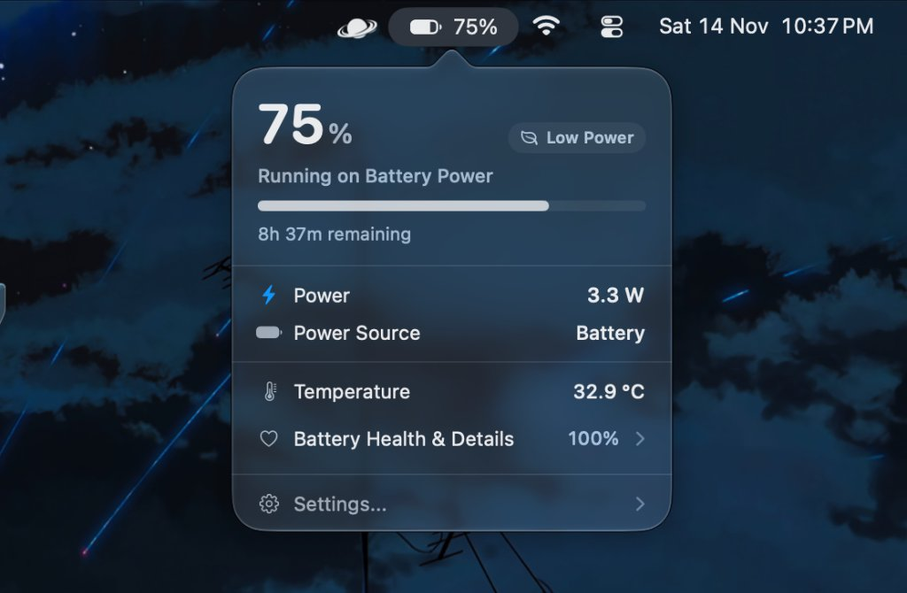
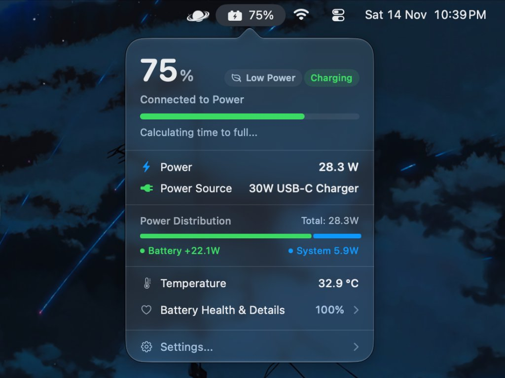
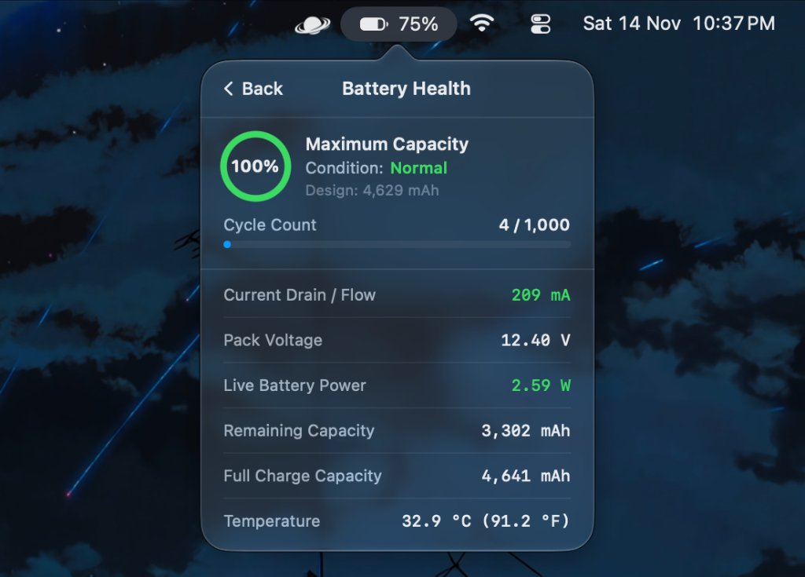

# ⚡ Wolt — Native macOS Battery & Power Adapter Monitor

A lightweight, clutter-free macOS menu bar application designed in Apple's native design language. Built with **Swift 6**, **SwiftUI**, and native **IOKit** power management APIs for Apple Silicon.

---

## 📸 App Preview

<p align="center">
  
  &nbsp;
  
  &nbsp;
  
</p>

| **Running on Battery** | **Connected to Power** | **Battery Health & Diagnostics** |
| :---: | :---: | :---: |
| Instantaneous system draw, remaining runtime, 1-click Low Power Mode toggle | Live USB-PD power, dual-proportion charging vs system distribution bar | True chemical health %, cycle count, live milliampere drain, pack voltage & capacity |

---

## 🌟 Why Wolt?

Unlike other battery monitors that overwhelm you with multi-tab dashboards, constant low-battery notifications, or background battery drain, **Wolt** keeps things minimalist, elegant, and fast.

* **⚡ Power Adapter & Live Meter:** Instantly detect the connected power adapter (e.g. *Xiaomi 67W Charger*, *Apple 30W/70W USB-C Adapter*), its rated wattage, and the real-time power flow into your Mac and battery.
* **🍃 1-Click Low Power Mode Toggle:** Effortlessly switch Low Power Mode on and off right from the popover home screen with native visual amber/yellow indicator.
* **🔄 Dual-Proportion Power Flow Bar:** Intelligently visualizes how much wall power charges the battery vs powering your Mac hardware.
* **🌡️ Live Battery Pack Temperature:** Direct hardware sensor extraction from `AppleSmartBatteryPack` in Celsius and Fahrenheit.
* **🔋 Dedicated Health & Electrical Diagnostics:** Real hardware cycle count, maximum chemical capacity %, pack voltage, and live milliampere (mA) current drain.
* **📌 Native macOS NSPopover with Notch:** Anchored directly to your status bar item with Apple's native pointer notch and silky-smooth spring slide animation.
* **🚀 Dual-Engine Startup:** Native `SMAppService` + User `LaunchAgent` for 100% reliable launch-at-login across all macOS restarts.
* **🪶 0% Bloat, < 1MB Size:** No third-party dependencies, no background daemons, zero tracking.

---

## 📸 Interface Overview

Wolt sits discreetly in your macOS menu bar. Clicking it opens a native translucent glass popover:

### 1. ⚡ Home Screen
* **Hero Battery Section:**
  * Clean large battery percentage (`75%`) with level capsule progress bar.
  * **1-Click Low Power Mode Toggle:** An interactive capsule button (`[leaf Low Power]`) that glows amber/yellow when active and updates macOS power state instantly.
  * Real-time remaining runtime estimate (or time to full charge).
* **Power & Source:**
  * Live power consumption / wall delivery in Watts (e.g. `12.1 W`).
  * Connected power source (e.g. `30W USB-C Charger` or `Battery`).
* **Power Distribution Bar (When Plugged In):**
  * Proportional bar showing exact allocation: e.g. `Battery +2.6W` • `System 9.4W`.
  * Automatic detection of hardware power bypass when full.
* **Temperature:**
  * Real-time battery temperature sensor readout (`32.9 °C`).
* **Direct Navigation:**
  * One-tap access to **Battery Health & Details** and **Settings...**.

### 2. 🔋 Dedicated Battery Health Page
* **Maximum Capacity Gauge:** Circular indicator of true chemical battery health (100% against factory design).
* **Cycle Counter:** Hardware cycle count with longevity progress bar (rated for 1,000 Apple Silicon cycles).
* **Real-Time Electrical & Drain Diagnostics:**
  * **Current Drain / Flow:** Live milliampere usage (e.g. `209 mA`).
  * **Pack Voltage:** Live battery bus voltage (e.g. `12.40 V`).
  * **Live Battery Power:** Net wattage into or out of cells (e.g. `2.59 W`).
  * **Charge Capacities:** Current usable (`3,302 mAh`) vs. full charge capacity (`4,641 mAh`).
  * **Temperature:** Reading in both °C and °F (`32.9 °C (91.2 °F)`).

### 3. ⚙️ Minimalist Settings Panel
* **Menu Bar Appearance:**
  * `Icon + Percentage` (Default) — Clean battery glyph + live percentage.
  * `Percentage Only` — Minimalist `%` display.
  * `Icon Only` — Subtle battery glyph.
  * `Icon + Wattage` — Displays live wattage directly in the menu bar.
* **Low Power Mode Permissions:** Setup 1-click passwordless toggle via standard sudoers rule.
* **Launch at Login:** Toggle to start Wolt automatically on boot.
* **Actions:** Manual refresh and quit actions.

---

## 🚀 How to Run Wolt

### Quick Launch (Pre-compiled .app)
The compiled application bundle is located in `build/Wolt.app`. You can launch it immediately:

1. **Via Terminal:**
   ```bash
   open build/Wolt.app
   ```
2. **Via Finder:**
   * Open the `build` folder in Finder.
   * Double-click **Wolt.app**.
   * It will appear immediately in your top-right macOS menu bar!

---

## 🛠️ Project Structure

```
Wolt/
├── build.sh                             # Automated build script (compiles Wolt.app)
├── build/
│   └── Wolt.app/                        # Ready-to-run native macOS application bundle
├── Resources/
│   ├── AppIcon.icns                     # High-resolution macOS application icon
│   └── Info.plist                       # macOS bundle configuration (LSUIElement = true)
├── Sources/
│   └── Wolt/
│       ├── App.swift                    # Single-instance mutex & NSApplicationDelegate
│       ├── Models/
│       │   ├── BatteryModel.swift       # Telemetry & Power Adapter data structures
│       │   └── AppSettings.swift        # Persistent preferences (UserDefaults)
│       ├── Services/
│       │   ├── PowerService.swift       # IOKit & IOPowerSources hardware bridge
│       │   └── StatusBarController.swift# Native NSStatusItem & NSPopover lifecycle
│       └── Views/
│           └── PopoverContentView.swift # Home screen, Health page & Settings view
└── Package.swift                        # Swift Package Manager manifest
```

---

## 🔨 Rebuilding from Source

If you make any changes to the Swift code, recompile instantly by running:
```bash
./build.sh
```
To package a production DMG installer:
```bash
./build.sh --dmg
```
This builds an optimized Apple Silicon binary in under 5 seconds using `swiftc`.
