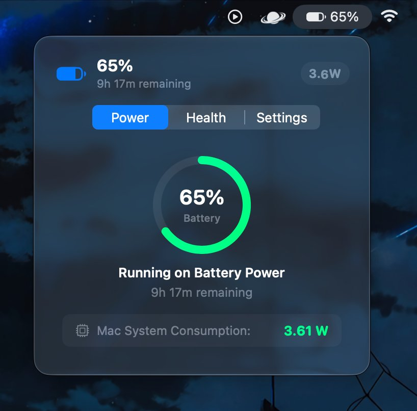
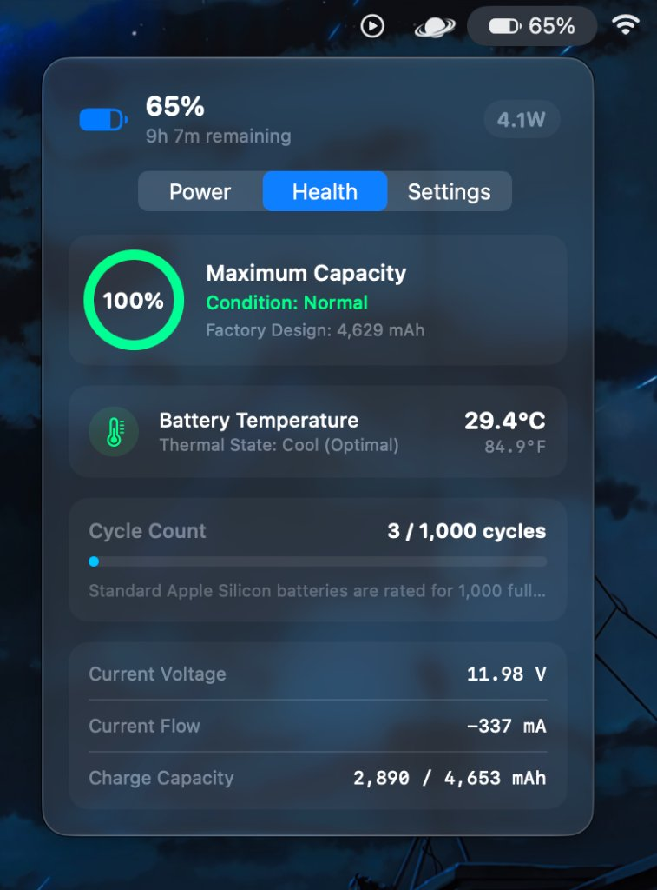

# ⚡ Wolt — Native macOS Battery & Power Adapter Monitor

A lightweight, clutter-free macOS menu bar application designed in Apple's native design language. Built with **Swift 6**, **SwiftUI**, and native **IOKit** power management APIs for Apple Silicon.

---

## 📸 App Preview

<p align="center">
  
  &nbsp;
  
</p>

| ⚡ **Live Power Flow & Discharge** | 🔋 **Battery Health & Thermal Telemetry** |
| :---: | :---: |
| Real-time system load, remaining runtime, live PMU wattage meter | True chemical health %, hardware pack temperature (°C & °F), cycle count |

---

## 🌟 Why Wolt?

Unlike other battery monitors that overwhelm you with multi-tab dashboards, constant low-battery notifications, or background battery drain, **Wolt** keeps things minimalist, elegant, and fast.

* **⚡ Power Adapter & Live Meter:** Instantly detect the connected power adapter (e.g. *Xiaomi 67W Charger*, *Apple 70W USB-C Adapter*), its rated wattage, and the real-time power flow into your Mac and battery.
* **🌡️ Live Battery Pack Temperature:** Direct hardware sensor extraction from `AppleSmartBatteryPack` in Celsius and Fahrenheit with thermal state badges (*Cool*, *Warm*, *Elevated*).
* **🔌 USB-IF Vendor ID Decoding:** Reads physical USB-PD vendor IDs directly from hardware registers to accurately identify third-party chargers (Xiaomi, Apple, Anker, Ugreen, Samsung).
* **🔄 Dual-Proportion Power Flow:** Intelligently visualizes charging mode vs supplemental battery assist when system demand exceeds charger supply.
* **🔋 Native Battery Health:** Real hardware cycle count, maximum capacity %, and factory design capacity.
* **🚀 Dual-Engine Startup:** Native `SMAppService` + User `LaunchAgent` for 100% reliable launch-at-login across all macOS restarts.
* **🪶 0% Bloat, < 1MB Size:** No third-party dependencies, no background daemons, zero tracking.

---

## 📸 Interface & Tab Overview

Wolt sits discreetly in your macOS menu bar. Clicking it opens a native translucent glass popover with three tabs:

### 1. ⚡ Power Flow Tab (Default View)
* **When Plugged In:**
  * Shows your connected adapter name (e.g., `Xiaomi 67W Charger`, `Apple 70W USB-C Power Adapter`).
  * Displays rated wattage (e.g., `67W`).
  * Shows visual power flow: Wall Adapter ──▶ Battery Charging + System Draw.
  * Status badge: `⚡ Optimal USB-PD Delivery`, `Supplemental Battery Mode`, or `Standby`.
* **When on Battery:**
  * Displays a circular battery ring with percentage.
  * Live discharge rate in Watts (e.g., `3.61 W`).
  * Remaining runtime estimate (e.g., `9h 17m remaining`).

### 2. 🔋 Health & Specs Tab
* **Maximum Capacity Gauge:** Circular indicator of true chemical battery health (100% against factory design).
* **Battery Pack Temperature:** Real-time sensor readout (e.g., `29.4°C / 84.9°F`) with thermal state monitoring.
* **Cycle Counter:** Hardware cycle count with longevity progress bar (rated for 1,000 Apple Silicon cycles).
* **Technical Metrics:**
  * Current Voltage (`11.98 V`)
  * Current Flow (`-337 mA`)
  * Battery Capacity (`2,890 / 4,653 mAh`)
  * Hardware Condition (`Normal / Healthy`)

### 3. ⚙️ Settings Tab
* **Menu Bar Appearance:**
  * `Icon + Percentage` (Default) — Clean battery glyph + live percentage.
  * `Percentage Only` — Minimalist `%` display.
  * `Icon Only` — Subtle battery glyph.
  * `Icon + Wattage` — Displays live wattage directly in the menu bar.
* **Launch at Login:** Toggle to start Wolt automatically on boot with live registration confirmation.
* **Branding & Actions:** High-resolution retina app icon, manual refresh, and quit actions.

---

## 🚀 How to Run Wolt

### Quick Launch (Pre-compiled .app)
The compiled application bundle is located in `build/Wolt.app`. You can launch it immediately:

1. **Via Terminal:**
   ```bash
   open build/Wolt.app
   ```
2. **Via Finder:**
   * Open the `build` folder in Finder.
   * Double-click **Wolt.app**.
   * It will appear immediately in your top-right macOS menu bar!

---

## 🛠️ Project Structure

```
Wolt/
├── build.sh                         # Automated build script (compiles Wolt.app)
├── build/
│   └── Wolt.app/                    # Ready-to-run native macOS application bundle
├── Resources/
│   └── Info.plist                   # macOS bundle configuration (LSUIElement = true)
├── Sources/
│   └── Wolt/
│       ├── App.swift                # App entry point with MenuBarExtra
│       ├── Models/
│       │   ├── BatteryModel.swift   # Telemetry & Power Adapter data structures
│       │   └── AppSettings.swift    # Persistent preferences (UserDefaults)
│       ├── Services/
│       │   └── PowerService.swift   # IOKit & IOPowerSources hardware bridge
│       ├── Views/
│       │   ├── PopoverContentView.swift # Main container with segmented tab bar
│       │   ├── PowerFlowTabView.swift   # Tab 1: Live power flow & adapter meter
│       │   ├── HealthTabView.swift      # Tab 2: Battery health, cycles, voltage
│       │   ├── SettingsTabView.swift    # Tab 3: Display mode & preferences
│       │   └── MenuBarLabelView.swift   # Dynamic menu bar icon/text
│       └── Widgets/
│           └── WoltWidgets.swift    # Native WidgetKit desktop & notification center widgets
└── Package.swift                    # Swift Package Manager manifest
```

---

## 🧩 Adding Desktop Widgets (WidgetKit)

The widget code is already written and ready in `Sources/Wolt/Widgets/WoltWidgets.swift`:
* **Small Widget:** Minimal circular battery gauge with centered wattage badge.
* **Medium Widget:** Split card with battery gauge on the left and live power flow / adapter details on the right.

To run the widgets, open the project in Xcode (`open Package.swift` or create an Xcode project) and add a **Widget Extension** target referencing `WoltWidgets.swift`.

---

## 🔨 Rebuilding from Source

If you make any changes to the Swift code, recompile instantly by running:
```bash
./build.sh
```
This builds an optimized Apple Silicon binary in under 5 seconds using `swiftc`.
